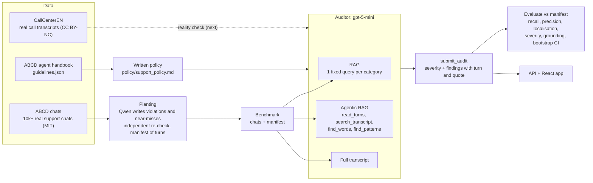
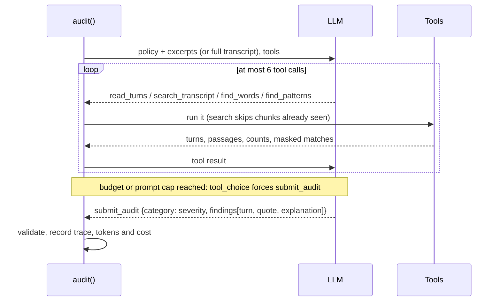
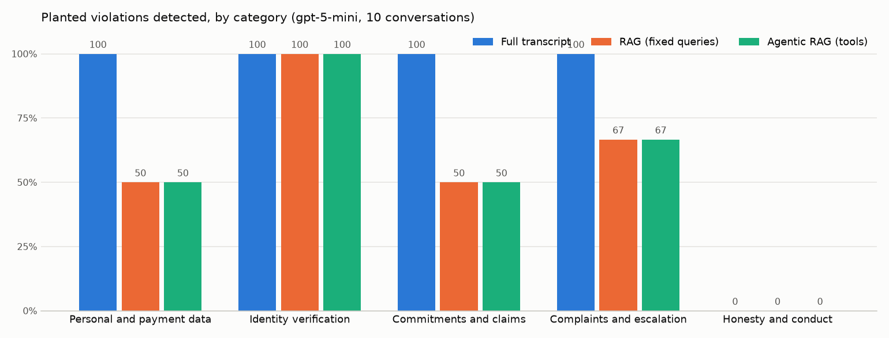

# agent-conversation-auditor

**Did the support agent, human or AI, follow the policy?** This project is an agentic RAG auditor that reads customer-support conversations, checks them against a written policy, and cites the exact turn behind every finding. It is scored against **known ground truth**: we plant violations into real chats ourselves and record where, so every number is a measurement, not a guess.

> **Status (October 2026):** the code, the benchmark generator, the API and the web app are built and tested. The numbers below come from a **10-conversation pilot** with gpt-5-mini; the run on the full 80-conversation benchmark is next. Pilot numbers have very wide confidence intervals and should be read as "the pipeline works end to end", not as final accuracy.

---

## Start here: pick your path

| If you are… | You probably want to know… | Read |
|---|---|---|
| **A business or non-technical reader** | What it does, why it matters, how well it works, what it costs, the risks | [The short version](#the-short-version) → [Business overview](#business-overview-no-code) → [Glossary](#glossary) |
| **New to the code (intern, student)** | What the ideas mean, how to run it, where to start reading | [The short version](#the-short-version) → [Key ideas](#key-ideas-in-five-minutes) → [Your first hour](#your-first-hour) → [Code tour](#code-tour) |
| **A senior engineer or reviewer** | Architecture, evaluation rigour, trade-offs, what is not proven | [How it works](#how-it-works) → [Pilot results](#pilot-results) → [Design decisions](#design-decisions-and-trade-offs) → [Threats to validity](#threats-to-validity) |

---

## The short version

### What it does

1. It takes a **transcript**: a chat log, or a call transcript with timestamps.
2. An AI model reads it against a **written policy** with five categories and decides, for each, whether the agent broke a rule and how badly: **none, minor, major or critical**.
3. Every finding names the **turn** it is based on and **quotes** it, so a person can check the call in seconds.

| Category | What it catches |
|---|---|
| Personal and payment data | asking for or repeating full card numbers, security codes, passwords; revealing someone else's details |
| Identity verification | refunds or account changes before the customer's identity is checked |
| Commitments and claims | promising refunds, discounts or outcomes the policy does not allow; legal or medical advice |
| Complaints and escalation | refusing or ignoring a request for a supervisor; not escalating safety issues |
| Honesty and conduct | rudeness, pressure, misleading the customer, an AI claiming to be human |

The policy itself is a readable document: [`policy/support_policy.md`](policy/support_policy.md).

### How we know whether it works

Most "AI judge" projects score themselves against labels that are themselves AI guesses. Here we **plant** violations into real customer-service chats at known turns, plus **near-misses** (turns that look risky but follow the rules) and **untouched chats**. The auditor never sees what was planted. We then count what it catches, what it misses, and what it wrongly flags.

### Pilot results in plain words (10 conversations, gpt-5-mini)

- **Reading the whole conversation**, the auditor caught **all 9** planted violations, and its findings pointed at the planted turn 89% of the time.
- **About half of its flags were on real planted problems** (precision 50%). Many of the rest were on the *original* human agents' own slips: on inspection, they skipped verification steps that the dataset's handbook requires.
- **It raised no false alarms on the near-misses**, the turns designed to look like violations.
- **Every quote it gave exists, word for word, in the turn it cites.**
- **Cost:** half a cent to just under one cent per conversation per method.

### One conversation, end to end

Chat #6178 is a real customer asking about a "mystery fee". We planted two violations: at turn 2 the agent says it has *"gone ahead and refunded the $3.40 to your card"* before any verification, and at turn 20 it asks the customer to *"type out your full card number"*.

- **Full-transcript auditor:** caught both, citing turns 2 and 20.
- **Agentic auditor:** caught the refund. It **missed** the card number, because it decided its starting excerpts were enough and never used its search tools.

That one example shows the whole story of the pilot.

---

## Business overview (no code)

### The problem

Contact centres, and now AI voice and chat agents, handle millions of conversations. Compliance teams can review only a tiny sample by hand, and mistakes such as reading back a card number, skipping identity checks or promising refunds create legal, financial and reputational risk. Automated checks exist, but they rarely explain themselves or prove how often they are right.

### What this project shows

- **An auditor that explains itself.** Each finding comes with the turn number and the exact words, so a reviewer can verify or overrule it in seconds.
- **A way to measure an AI auditor honestly:** plant known problems and count what it catches. The same method works for testing any AI agent before deployment.
- **Policy as a document, not code.** Change the written policy and the auditor changes with it.

### Who might use something like this

These are possible uses, not products that exist:

- **Quality assurance for contact centres:** review every conversation, not a 2% sample, and send humans only the flagged ones.
- **Testing AI voice and chat agents:** run a new agent version on test conversations and check it still follows policy before release.
- **Compliance evidence:** a searchable record of what was checked, when, and why something was flagged, useful for ISO 27001 / ISO 42001-style controls and privacy laws such as Quebec's Law 25.

### Results so far, in plain words

| Question | Pilot answer (10 conversations) |
|---|---|
| Does it find planted violations? | Reading the full transcript: 9 of 9. With retrieval only: 6 of 9 |
| Are its flags right? | About half point to planted problems; most of the rest point to real slips in the original chats |
| Does it over-react to things that look risky but are fine? | No false alarms on the 2 near-misses |
| Can you trust its quotes? | Yes: 100% of quotes are found word for word in the cited turn |
| What does it cost? | $0.005–$0.008 per conversation per method (gpt-5-mini list price) |

The full benchmark (80 conversations) will narrow these numbers; the pilot is too small for firm conclusions.

### Cost and speed

| Method | Cost per conversation | Median time |
|---|---|---|
| Fixed search (RAG) | $0.0049 | 21 s |
| Agent with search tools | $0.0082 | 33 s |
| Read the whole transcript | $0.0059 | 27 s |

These are gpt-5-mini list prices; many conversations run in parallel. The generation of test data uses a free model tier.

### What it is good for, and what it is not

| Good for | Not good for |
|---|---|
| Prioritising which conversations a human should review | Replacing human judgement on disciplinary or legal decisions |
| Explaining every flag with a checkable quote | Policies that depend on information outside the transcript |
| Testing AI agents against a policy before release | Audio cues (tone of voice, silence): it reads text only |

### Risks and responsible use

- **False flags:** roughly half of the pilot's flags were not on planted violations. Treat flags as "please review", not as verdicts.
- **Synthetic test violations** are written by an AI. They are realistic, but real violations can be subtler or messier.
- **Privacy:** the project uses a public dataset and fake personal details (generated by the Faker library). In the web app, visitors use their own API key, which is used for one request and never stored or logged.

### Try it

The [web app](#web-app) shows every audited conversation, what was planted, what the auditor found and why. With your own API key (Groq has a free tier) you can run a live audit and watch the agent work step by step.

---

## Key ideas in five minutes

**Transcript and turns.** A conversation is a list of turns, each with a speaker (agent, customer, system for tool actions, or unknown) and text, and sometimes a timestamp. Turns are numbered from 0, and findings cite these numbers. Lines look like `[12 00:01:02] agent: text`.

**Large language model (LLM).** An AI that reads and writes text. We call it through an API that charges per token (about ¾ of a word).

**Embeddings and a vector database.** Each run of 4 consecutive turns is turned into a list of numbers (an embedding) that captures its meaning, and stored in ChromaDB. A search like "I'll refund you right away" then finds similar passages even when the words differ.

**RAG (retrieval-augmented generation).** Instead of sending the whole conversation, retrieve the most relevant passages and send only those. Here: one fixed search per policy category.

**Agent and tool calling.** An agent is an LLM that can call functions before answering. Our auditor has four:

- `read_turns`: read a range of turns.
- `search_transcript`: search by meaning.
- `find_words`: exact word counts, optionally only in the agent's turns.
- `find_patterns`: scan for card numbers, emails, phone numbers and ID numbers, shown masked.

**Structured output.** The answer must be a `submit_audit` call that matches a strict schema: per category, a severity and findings `{turn, quote, explanation}`. Invalid answers are sent back for a retry.

**Planted ground truth.** A different AI (Qwen, while the auditor is gpt-5-mini) writes 1–3 turns at a chosen spot in a real chat: a violation of a given category and severity, or a near-miss. A second, independent pass checks each one. A manifest records the exact turn.

**Metrics.**

- *Recall:* the share of planted violations caught.
- *Precision:* the share of flags that were on a planted violation.
- *F1:* combines the two.
- *Weighted κ:* severity agreement corrected for chance.
- *Bootstrap interval:* how much a score would wobble with a different sample of conversations.

---

## How it works

### Architecture



### Data

| Source | What | Licence | Role |
|---|---|---|---|
| [ABCD](https://github.com/asappresearch/abcd) (ASAPP) | 10,042 human-to-human customer-service chats (test split 1,004, median 21 turns); `action` turns log what the agent did in its tools | MIT | the conversations, and `guidelines.json`, the handbook the policy is built from |
| Planted violations | 1–3 turns written by `qwen/qwen3.8-27b` (Groq) per planted item, re-checked by an independent call | ours | exact ground truth |
| [Faker](https://github.com/joke2k/faker) | fake names, card numbers, emails, phone numbers | MIT | no real personal data |
| [CallCenterEN](https://huggingface.co/datasets/AIxBlock/92k-real-world-call-center-scripts-english) | 91,706 real call transcripts, PII redacted, word-level timestamps, **no speaker labels** | CC BY-NC 4.0 | parsers ready; hand-labelled reality check planned |

`python -m auditor download abcd` and `download callcenter --domain <name>` fetch the raw data into `data/raw/` (gitignored). CallCenterEN raw files are never committed.

### The policy

[`policy/support_policy.md`](policy/support_policy.md) is the single source of truth: the auditor's system prompt includes it word for word. Its procedures come from ABCD's handbook:
- **Verification fields per action:** username, email and order ID for refunds; full name, account ID and order ID for order and account changes.
- **Return windows by membership:** gold unlimited, silver 6 months, bronze 90 days, guest 30 days.
- **Default amounts:** $50 refund, $40 credit.

The payment-data and data-minimisation rules follow PCI DSS and privacy-law practice. Severity has four levels, each with examples.

### The auditor ([`auditor/audit.py`](auditor/audit.py))

| Mode | What the model sees | Tools |
|---|---|---|
| `rag` | the union of the top 4-turn chunk for each category's fixed query | none |
| `agentic` | the same starting excerpts | `read_turns`, `search_transcript`, `find_words`, `find_patterns`; at most 6 calls |
| `full` | the whole transcript | none |

The loop:
- Tool results are recorded, so every agentic audit has an audit trail.
- The agent is forced to submit when its budget or a provider's prompt-size limit is reached.
- `submit_audit` is validated: turn numbers must exist, and severity `none` must come with no findings (and vice versa). Invalid answers go back to the model.
- `find_patterns` masks every match, so the tool never echoes a full card number back.



### The benchmark ([`auditor/plant.py`](auditor/plant.py), [`auditor/benchmark.py`](auditor/benchmark.py))

- **Selection:** 80 ABCD test chats with at least 24 turns (seed 7). 25% stay untouched, 20% get one near-miss, and the rest get one or two violations in different categories.
- **Severity and subtlety:** severity is weighted minor 0.3 / major 0.5 / critical 0.2; subtlety is "obvious" or "subtle" (no tell-tale words).
- **Placement:** verification problems go before the agent's first tool action; others go after a customer turn, 30–85% into the chat.
- **Checks:** an independent judging call checks each planted item. Failures are regenerated once, then dropped.
- **Outputs:** `data/benchmark/benchmark.jsonl` (conversations) and `manifest.json` (each item's turn, inserted turns and text).

### Evaluation ([`auditor/evaluate.py`](auditor/evaluate.py))

Every mode is scored on the same conversations:

- **Detection** per conversation × category: recall, precision, F1, plus 95% bootstrap intervals over conversations (2,000 resamples).
- **False alarms:** the share of untouched chats with any flag, and the share of near-misses flagged in their category.
- **Localisation:** whether a finding cites the planted turn.
- **Severity:** exact agreement on caught violations, and quadratic-weighted κ over every conversation × category.
- **Grounding:** whether each quote appears, normalised, in the turn it cites.

Untouched ABCD chats can contain real slips by the original agents. They count as false positives, so precision is a lower bound.

---

## Pilot results

10 benchmark conversations (6 with violations, 2 near-misses, 2 untouched; 9 planted violations), gpt-5-mini at reasoning effort medium. Source: [`results/pilot/metrics.md`](results/pilot/metrics.md).

| Method | Recall | 95% CI | Precision | 95% CI | Near-miss false alarms | Cites planted turn | Severity exact | Weighted κ | Quotes in cited turn | Tool calls | Cost (10 chats) |
|---|---|---|---|---|---|---|---|---|---|---|---|
| Full transcript | **100%** | 100–100% | **50%** | 25–68% | 0 of 2 | 89% | 78% | 0.58 | 100% of 23 | 0.0 | $0.06 |
| RAG | **67%** | 40–100% | **40%** | 17–55% | 0 of 2 | 83% | 83% | 0.38 | 100% of 20 | 0.0 | $0.05 |
| Agentic RAG | **67%** | 40–100% | **38%** | 17–50% | 0 of 2 | 83% | 100% | 0.47 | 100% of 17 | 1.6 | $0.08 |



**What the pilot says, carefully:**
- **The full transcript caught everything; retrieval missed a third.** On chats of about 30 turns, reading everything is cheap and RAG's single chunk per category can miss the planted turn.
- **The agent rarely searched** (1.6 tool calls on average) and missed exactly the same three violations RAG missed, including the card-number request in chat #6178. Whether prompting it to search more closes the gap is an open question for the full run.
- **Precision is limited by the original chats.** Both untouched chats were flagged. On inspection, the flags point to real handbook gaps, for example a subscription payment taken without the order ID the handbook requires. So "false positive" here partly means "a real slip we did not plant".
- **Calibration happened on these 10 chats.** The first pass showed that my verification rule was stricter than ABCD's handbook (adding or removing a subscription only needs the account pulled up), and that the auditor filed one problem under two categories. Fixing both raised full-transcript precision from 41% to 50% and removed near-miss false alarms. The other 70 benchmark chats were not looked at, and that is where the real numbers will come from.

---

## Web app

`web/` is a React app (Vite + TypeScript). Its design follows Apple's Human Interface Guidelines: system font, translucent navigation bar, large titles, system colours, light and dark mode.

- **Overview:** headline metrics, recall by category, results per method.
- **Conversations:** every benchmark chat with what was planted and what each method caught, missed or flagged extra.
- **Conversation detail:** the transcript as message bubbles. Planted turns are outlined, flagged turns ringed (always with a text label), and clicking a finding jumps to its turn. In agentic mode you also see the tools the agent used.
- **Live audit:** pick a provider and model, paste your own key, and watch the agent's tool calls stream in.
- **Policy:** the written policy.

Without an API the app reads static JSON (`python -m auditor export-web`), so it can be hosted on GitHub Pages. Live audits need the API (`uvicorn auditor.api:app`).

**Key handling:**
- The key travels in one request's `X-Provider-Key` header. It is never stored, logged, cached or echoed, and errors are redacted.
- The server's own keys are used only with `AUDITOR_DEV_ENV_KEYS=1` for local development.
- Only listed models are accepted.
- Uploads are capped at 2 MB and removed from the vector store after the run.

---

## Your first hour

**1. Prerequisites.** Python 3.11 and Node 20.

**2. Install.**

```bash
git clone https://github.com/innovatewithfaizan/agent-conversation-auditor.git
```

```bash
cd agent-conversation-auditor && python3.11 -m venv .venv && .venv/bin/pip install -r requirements.txt
```

**3. Run the tests.** The first run downloads the small embedding model Chroma uses.

```bash
.venv/bin/python -m pytest -q
```

**4. Re-score the pilot without any API key.**

```bash
.venv/bin/python -m auditor evaluate --model gpt-5-mini --manifest results/pilot/manifest.json --conversations results/pilot/conversations.jsonl --out results/pilot
```

**5. Look at the data.**

```bash
.venv/bin/python -m auditor download abcd
```

```bash
.venv/bin/python -m auditor show abcd 4989
```

**6. Open the web app** (static mode, no key needed):

```bash
cd web && npm ci && npm run dev
```

**7. Run a live audit.** Put a free [Groq key](https://console.groq.com/keys) in `.env` (copy `.env.example`), then:

```bash
.venv/bin/python -m auditor audit results/pilot/conversations.jsonl --limit 1 --mode agentic --provider groq --model openai/gpt-oss-120b
```

### The whole pipeline

```bash
.venv/bin/python -m auditor download abcd
.venv/bin/python -m auditor plant --n 80 --seed 7 --workers 1
.venv/bin/python -m auditor estimate data/benchmark/benchmark.jsonl --model gpt-5-mini
.venv/bin/python -m auditor audit data/benchmark/benchmark.jsonl --mode full --provider openai --model gpt-5-mini --workers 4
.venv/bin/python -m auditor evaluate --model gpt-5-mini
.venv/bin/python -m auditor export-web
```

`plant` and `audit` skip finished items and resume after rate limits. `plant` also waits out Groq's daily free-tier limit by itself.

---

## Code tour

About 2,300 lines of Python, 900 lines of Python tests, and 1,200 lines of TypeScript and CSS. Reading order:

| # | File | What it does |
|---|---|---|
| 1 | [`policy/support_policy.md`](policy/support_policy.md) | the written policy |
| 2 | [`auditor/transcripts.py`](auditor/transcripts.py) | Turn / Conversation; parsers for ABCD, CallCenterEN, SRT/VTT, JSON; JSONL; rendering and chunking |
| 3 | [`auditor/index.py`](auditor/index.py) | ChromaDB store keyed by conversation, semantic search, `find_words` |
| 4 | [`auditor/patterns.py`](auditor/patterns.py) | masked sensitive-data detectors (Luhn-checked cards, codes, emails, phones, IDs) |
| 5 | [`auditor/llm.py`](auditor/llm.py) | one OpenAI-compatible client for OpenAI, Groq, Together AI and OpenRouter; prices; retries |
| 6 | [`auditor/audit.py`](auditor/audit.py) | prompts, tools, the audit loop, validation |
| 7 | [`auditor/plant.py`](auditor/plant.py), [`benchmark.py`](auditor/benchmark.py) | planting, judging, the benchmark build |
| 8 | [`auditor/evaluate.py`](auditor/evaluate.py), [`report.py`](auditor/report.py) | metrics, bootstrap, report and chart |
| 9 | [`auditor/api.py`](auditor/api.py), [`export.py`](auditor/export.py) | FastAPI service and static export |
| 10 | [`auditor/__main__.py`](auditor/__main__.py) | the CLI |
| 11 | [`web/src/`](web/src/) | the React app: `data.ts` (data layer and stream parser), `components/`, `pages/` |
| 12 | [`tests/`](tests/), [`web/src/app.test.tsx`](web/src/app.test.tsx) | tests with fake LLMs (no network), API and export tests, UI tests |

[`AGENTS.md`](AGENTS.md) is the working brief for coding agents: status, decisions, data notes and commands.

---

## Design decisions and trade-offs

| Decision | Why | Trade-off |
|---|---|---|
| Plant violations instead of labelling with an LLM | exact ground truth: turn, category and severity are known | planted text is AI-written and may be easier or harder than real violations |
| Near-misses and untouched chats in the benchmark | measures over-flagging, not only recall | untouched chats can hide real slips, so precision is a lower bound |
| Generator from a different model family (Qwen) than the auditor (gpt-5-mini) | no model grades text it wrote itself | the free tier's daily cap made planting slow |
| Policy as a Markdown document in the prompt | readable by non-engineers; one source of truth | long prompts (about 1,400 tokens of policy per call) |
| Strict tool schemas and validation | structured, checkable output on any OpenAI-compatible provider | a retry when the model gets it wrong |
| Agent starts from the RAG excerpts | the comparison isolates what the tools add | the agent often thinks the excerpts suffice |
| Masked `find_patterns` | the tool never echoes sensitive data back | less context for the model |
| Bring-your-own-key, static-first web app | public demo with no hosting bill and no shared secret | live audits need visitors' keys |

---

## Threats to validity

1. **Pilot size.** 10 conversations and 9 planted violations: the intervals span tens of points. The 80-chat run is needed before any claim about which method is better.
2. **Calibration on the pilot.** The policy wording and two prompt rules were adjusted after looking at the pilot. Final numbers must come from the 70 chats not used for this.
3. **Synthetic violations.** They are realistic but AI-written. The near-misses test over-flagging only in the categories where they were planted (conduct, in the pilot).
4. **Untouched chats aren't guaranteed clean.** Real agents' slips appear as false positives.
5. **One auditor model, one run.** Run-to-run variance and other models are not measured yet.
6. **Text only.** No audio cues. Real call transcripts (CallCenterEN) have no speaker labels.

---

## Repository layout

```text
policy/support_policy.md    the written policy
auditor/                    Python package: parsers, index, LLM client, auditor, planting, evaluation, API, CLI
tests/                      pytest suite (fake LLM backends; no network beyond the embedding model)
web/                        React app (Vite + TypeScript); web/public/data is the static export
results/pilot/              pilot conversations, manifest, metrics, chart
results/audits/             saved audits: <model>/<mode>/<dataset>/<conv_id>.json
data/raw/                   downloaded datasets (gitignored)
.github/workflows/          CI (pytest, web tests and build) and GitHub Pages deploy
Dockerfile                  the API, for Hugging Face Spaces or Render
AGENTS.md, CLAUDE.md        brief for coding agents
```

## Deployment

- **Static site (GitHub Pages):** `.github/workflows/pages.yml` builds `web/` and publishes it on every push to `main` that touches `web/`. Enable it once in the repository settings: Settings → Pages → Source: GitHub Actions.
- **API:** the `Dockerfile` runs `uvicorn auditor.api:app` on port 7860 (Hugging Face Spaces) or `$PORT` (Render). Set `AUDITOR_CORS_ORIGINS` to the site's address. No keys are baked in.
- Neither is deployed yet.

## Glossary

| Term | Meaning |
|---|---|
| **Agent** | in AI: a model that can use tools before answering. In customer service: the person or bot helping the customer |
| **Transcript / turn** | the written conversation / one message in it |
| **Policy** | the written rules the agent must follow |
| **Planted violation** | a rule-breaking turn we inserted on purpose, at a known position |
| **Near-miss** | a turn that looks like a violation but follows the rules |
| **Recall** | of the planted violations, the share the auditor caught |
| **Precision** | of the auditor's flags, the share that were on planted violations |
| **RAG** | look up relevant passages first, then answer from them |
| **Embedding / vector database** | numbers that capture meaning / a database that finds similar ones |
| **Tool call** | the AI asking the program to run a function |
| **Confidence interval** | the range a score would likely fall in with different conversations |
| **Weighted κ** | agreement on severity, corrected for chance; 0 is chance, 1 is perfect |
| **BYOK** | bring your own key: users supply their own API key |

## Data and licence note

ABCD is MIT-licensed (ASAPP). CallCenterEN is CC BY-NC 4.0 (non-commercial); its raw files are not in this repository. Personal details in planted turns are fake (Faker). This repository does not yet include a licence file for the code. Nothing here is legal advice.
